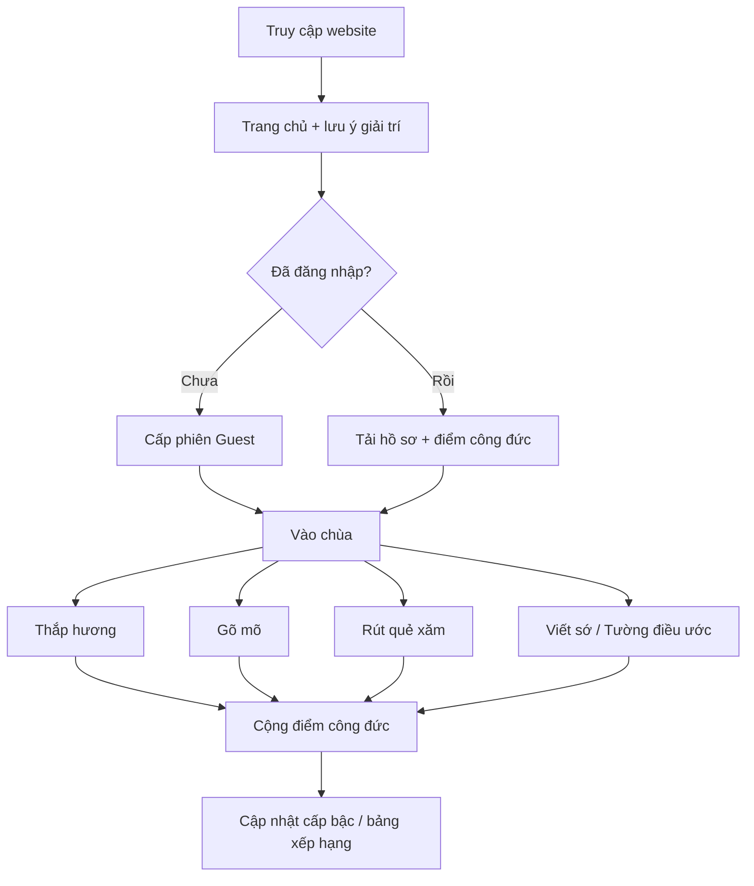
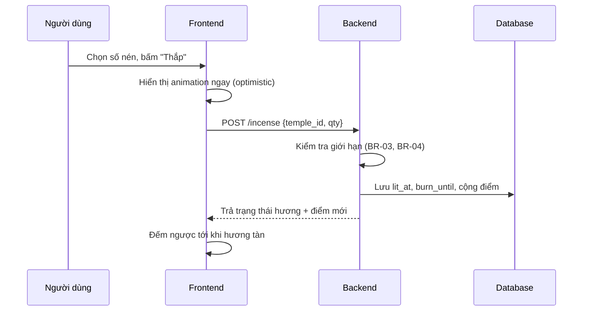
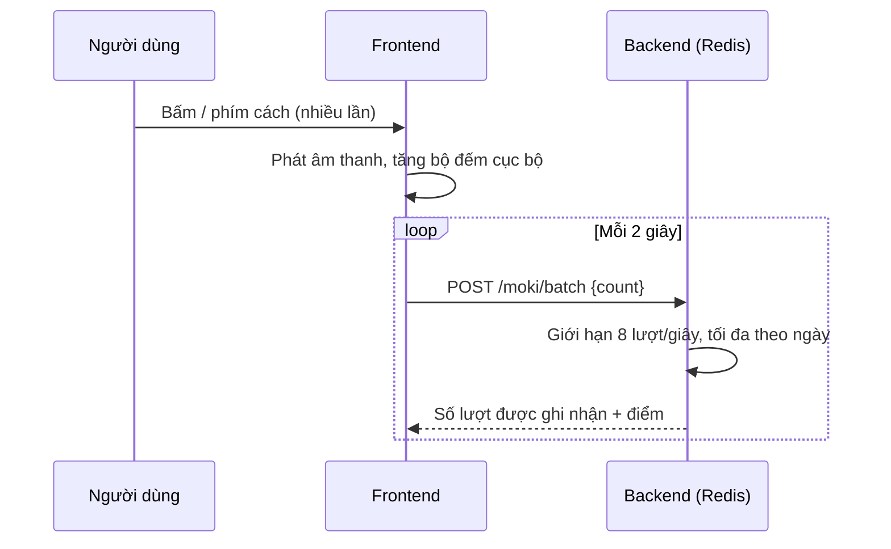
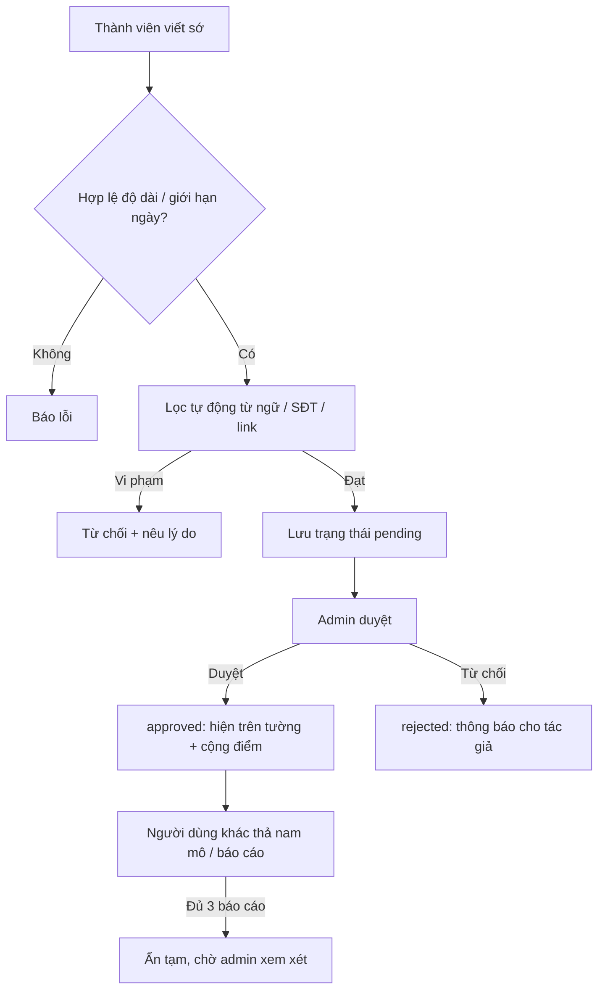
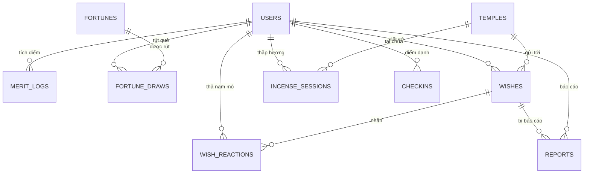
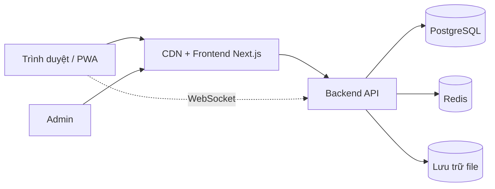

# Website "Đi Chùa Online" — Phân tích & Kế hoạch triển khai

> **Phiên bản:** 1.0 · **Ngày lập:** 17/10/2026
>
> **Giả định ban đầu** (có thể đổi, xem mục 15):
> - Hướng sản phẩm: **kết hợp vui vẻ + tôn trọng** (gõ mõ, rút quẻ, thắp hương, viết sớ), không mê tín hóa, không thu tiền.
> - Đội ngũ: **1 lập trình viên** (làm bán thời gian), thời gian dự kiến **8 tuần**.
> - Ưu tiên ra **MVP chạy được sớm**, sau đó mới mở rộng.

---

## 1. Tổng quan

### 1.1. Ý tưởng
Một website cho phép người dùng "đi chùa" trực tuyến: vào không gian chùa ảo, thắp hương, dâng lễ, gõ mõ, rút quẻ xăm, viết sớ gửi điều ước và nghe nhạc thiền/kinh. Người dùng tích lũy **điểm công đức** (điểm ảo) và có thể chia sẻ kết quả.

### 1.2. Mục tiêu
| # | Mục tiêu | Cách đo |
|---|----------|---------|
| 1 | Mang lại trải nghiệm thư giãn, tĩnh tâm hoặc giải trí nhẹ nhàng | Thời gian ở lại trang, tỷ lệ quay lại |
| 2 | Tương tác đơn giản, dùng được ngay trên điện thoại, không cần đăng ký | Thao tác đầu tiên < 10 giây sau khi vào trang |
| 3 | Có yếu tố lan truyền (chia sẻ quẻ xăm, bảng xếp hạng) | Số lượt chia sẻ |
| 4 | Giữ không gian lành mạnh, an toàn nội dung | Tỷ lệ nội dung vi phạm bị xử lý |

### 1.3. Ngoài phạm vi (không làm)
- Không nhận tiền, quyên góp, bán "công đức" hay vật phẩm thật.
- Không dự đoán vận mệnh nghiêm túc hay tư vấn tâm linh (chỉ mang tính giải trí).
- Không làm app native ở giai đoạn đầu (chỉ web responsive/PWA).
- Không phát livestream chùa thật, không dùng hình ảnh/âm thanh vi phạm bản quyền.

---

## 2. Phân tích bài toán

### 2.1. Đối tượng người dùng
| Nhóm | Nhu cầu | Hành vi dự kiến |
|------|---------|-----------------|
| Người trẻ (Gen Z) | Giải trí, xả stress, "cầu may" trước thi cử, deadline | Vào nhanh, gõ mõ, rút quẻ, chia sẻ lên mạng xã hội |
| Người đi làm bận rộn | Tĩnh tâm vài phút, không có thời gian đến chùa | Thắp hương, nghe nhạc thiền, viết sớ |
| Người xa quê/xa nhà | Giữ thói quen đi chùa dịp rằm, mùng 1, lễ Tết | Truy cập theo lịch âm, gửi điều ước |
| Người quản trị | Quản lý nội dung, kiểm duyệt | Duyệt sớ, thêm quẻ, xem thống kê |

### 2.2. Vấn đề cần giải quyết
- Người dùng muốn trải nghiệm "đi chùa" nhưng bị hạn chế về thời gian, khoảng cách.
- Cần một trải nghiệm **nhẹ, nhanh, đẹp, trang nhã**, không quảng cáo gây rối.
- Cần kiểm soát nội dung do người dùng tạo (sớ, điều ước) để tránh thô tục, spam, lộ thông tin cá nhân.
- Cần chống gian lận số liệu (bot gõ mõ liên tục để leo bảng xếp hạng).

### 2.3. Tính nhạy cảm cần lưu ý
- Tôn giáo/tín ngưỡng là chủ đề nhạy cảm: ngôn ngữ, hình ảnh, âm thanh cần tôn trọng.
- Tránh tạo cảm giác "mua bán công đức" hoặc cam kết linh nghiệm.
- Hiển thị dòng lưu ý: *"Trang web mang tính giải trí và tĩnh tâm, không thay thế các nghi lễ thực tế."*

---

## 3. Phân quyền / vai trò (Actors)

| Vai trò | Mô tả | Quyền chính |
|---------|-------|-------------|
| **Khách (Guest)** | Chưa đăng nhập, được cấp phiên ẩn danh (lưu `guest_id` ở trình duyệt) | Thắp hương, gõ mõ, rút quẻ, xem tường điều ước; điểm lưu tạm, không lên bảng xếp hạng |
| **Thành viên (User)** | Đã đăng ký/đăng nhập | Toàn bộ chức năng của khách + lưu công đức, viết sớ, điểm danh chuỗi ngày, lên bảng xếp hạng, xem lịch sử quẻ |
| **Quản trị viên (Admin)** | Người vận hành | Quản lý chùa, quẻ xăm, duyệt/xóa sớ, xử lý báo cáo, xem thống kê |

---

## 4. Yêu cầu chức năng

**Ưu tiên (MoSCoW):** M = Must (MVP), S = Should, C = Could.

| ID | Chức năng | Mô tả ngắn | Ưu tiên |
|----|-----------|-----------|---------|
| FR-01 | Trang chủ & vào chùa | Giới thiệu, nút "Vào chùa", lưu ý giải trí | M |
| FR-02 | Thắp hương | Chọn số nén (1/3), animation khói, đếm thời gian cháy | M |
| FR-03 | Dâng lễ | Chọn hoa, quả, đèn đặt lên bàn thờ (vật phẩm ảo) | S |
| FR-04 | Gõ mõ | Bấm/nhấn phím cách để gõ, có âm thanh và hiệu ứng "+1" | M |
| FR-05 | Rút quẻ xăm | Lắc ống xăm, ra quẻ kèm lời giải; xem lại lịch sử | M |
| FR-06 | Viết sớ / điều ước | Nhập nội dung, chọn ẩn danh, gửi để duyệt | S |
| FR-07 | Tường điều ước | Xem sớ đã duyệt, thả "nam mô" (reaction) cầu chúc | S |
| FR-08 | Điểm công đức & cấp bậc | Tích điểm từ hoạt động, lên cấp theo mốc | M |
| FR-09 | Tài khoản | Đăng ký/đăng nhập (email hoặc Google), hồ sơ đơn giản | M |
| FR-10 | Âm thanh & nhạc nền | Nhạc thiền/kinh, nút bật/tắt, chỉnh âm lượng | M |
| FR-11 | Lịch & nhắc | Hiển thị âm lịch, rằm, mùng 1, ngày lễ lớn; thông báo trong trang | C |
| FR-12 | Bảng xếp hạng | Top công đức theo ngày/tuần/tháng | C |
| FR-13 | Chia sẻ | Tạo ảnh "thẻ quẻ xăm" để chia sẻ mạng xã hội | C |
| FR-14 | Báo cáo vi phạm | Người dùng báo cáo sớ không phù hợp | S |
| FR-15 | Trang quản trị | CRUD chùa/quẻ, duyệt sớ, xử lý báo cáo, thống kê | S |
| FR-16 | Chọn chùa | Nhiều không gian chùa (nền, nhạc, màu sắc khác nhau) | C |
| FR-17 | Thiền hẹn giờ | Bộ đếm giờ tĩnh tâm 5/10/15 phút kèm chuông | C |
| FR-18 | Đa ngôn ngữ | Tiếng Việt, tiếng Anh | C |

---

## 5. Yêu cầu phi chức năng

| Nhóm | Yêu cầu |
|------|---------|
| Hiệu năng | LCP < 2.5s trên 4G; âm thanh nạp lười (lazy load); tương tác gõ mõ không giật (>= 30 FPS) |
| Tương thích | Mobile-first; hỗ trợ Chrome, Safari, Firefox, Edge bản mới |
| Khả năng truy cập | Có nút tắt âm; tôn trọng `prefers-reduced-motion`; tương phản chữ đủ; điều khiển được bằng bàn phím |
| Bảo mật | HTTPS, chống XSS khi hiển thị sớ, chống CSRF, rate limit, băm mật khẩu (bcrypt/argon2), không lưu dữ liệu nhạy cảm |
| Riêng tư | Cho phép ẩn danh; chỉ thu thập dữ liệu cần thiết; có trang chính sách riêng tư |
| Độ tin cậy | Lỗi API không làm hỏng trải nghiệm (hoạt động tạm thời ở client, đồng bộ lại sau) |
| Bảo trì | Mã nguồn có cấu trúc, có lint, test cho nghiệp vụ lõi, CI cơ bản |
| Mở rộng | Có thể thêm chùa, quẻ, vật phẩm mà không sửa code (dữ liệu cấu hình trong DB) |

---

## 6. Quy tắc nghiệp vụ (Business Rules)

### 6.1. Thắp hương (FR-02)
- **BR-01:** Mỗi lần thắp có thể chọn **1 hoặc 3 nén**.
- **BR-02:** Mỗi nén cháy trong **5 phút** (hiệu ứng), hết giờ chuyển sang "tàn hương".
- **BR-03:** Một bàn thờ tối đa **9 nén cháy cùng lúc** (tránh spam hiệu ứng).
- **BR-04:** Mỗi lần thắp hương cộng **+1 điểm công đức**; tối đa **10 điểm/ngày** từ hương.
- **BR-05:** Trạng thái hương lưu theo thời gian (`lit_at`, `burn_until`) để khi tải lại trang vẫn thấy hương đang cháy.

### 6.2. Gõ mõ (FR-04)
- **BR-06:** Mỗi lượt gõ là **1 tiếng mõ**; hiển thị bộ đếm tiếng mõ ngay lập tức ở client.
- **BR-07:** Client gom lượt gõ và gửi lên server **mỗi 2 giây** (batch) kèm số lượt.
- **BR-08:** Server giới hạn tối đa **8 lượt gõ/giây** mỗi phiên; phần vượt quá bị bỏ qua.
- **BR-09:** Quy đổi: **10 tiếng mõ = 1 điểm công đức**, tối đa **50 điểm/ngày** từ mõ.
- **BR-10:** Khách (guest) vẫn gõ được nhưng điểm không lên bảng xếp hạng.

### 6.3. Rút quẻ xăm (FR-05)
- **BR-11:** Phải **thắp ít nhất 1 nén hương** trong phiên trước khi được rút quẻ (tạo cảm giác nghi lễ).
- **BR-12:** Tối đa **3 lần rút/ngày/người dùng**; quẻ rút ra không trùng quẻ đã rút trong **7 ngày gần nhất**.
- **BR-13:** Mỗi quẻ gồm: số quẻ, tên quẻ, mức (Thượng cát/Trung cát/Bình/...), lời thơ ngắn, lời giải theo các chủ đề (học tập, công việc, tình cảm, sức khỏe) mang tính **động viên, tích cực**.
- **BR-14:** Nội dung quẻ do **tự biên soạn** (không sao chép nguồn có bản quyền), gắn dòng "chỉ mang tính giải trí".
- **BR-15:** Rút quẻ lần đầu trong ngày **+3 điểm công đức**; các lần sau không cộng.

### 6.4. Viết sớ / điều ước (FR-06, FR-07)
- **BR-16:** Chỉ **thành viên đã đăng nhập** mới được viết sớ; tối đa **3 sớ/ngày**.
- **BR-17:** Độ dài **10–280 ký tự**; cho phép chọn **ẩn danh**.
- **BR-18:** Hệ thống **tự động lọc**: từ ngữ thô tục, số điện thoại, email, đường link, tên riêng nhạy cảm; vi phạm bị từ chối kèm lý do.
- **BR-19:** Sớ qua lọc tự động có trạng thái `pending`; **admin duyệt** (hoặc tự duyệt nếu hệ thống đánh giá an toàn ở giai đoạn sau) → `approved` / `rejected`.
- **BR-20:** Chỉ sớ `approved` hiển thị trên tường điều ước.
- **BR-21:** Mỗi người thả "nam mô" (reaction) **1 lần/sớ**; không tự thả cho sớ của mình.
- **BR-22:** Sớ nhận **≥ 3 báo cáo** từ người dùng khác tự động ẩn chờ admin xem xét.

### 6.5. Điểm công đức & cấp bậc (FR-08)
- **BR-23:** Điểm công đức là **điểm ảo**, không quy đổi ra tiền hay quà.
- **BR-24:** Nguồn điểm: thắp hương, gõ mõ, rút quẻ lần đầu, viết sớ được duyệt (+5), điểm danh hằng ngày (+2, có thưởng chuỗi).
- **BR-25:** Cấp bậc (có thể đổi tên): Sơ tâm (0) → Tinh tấn (100) → An nhiên (500) → Thanh tịnh (1.500) → Từ bi (5.000).
- **BR-26:** Giới hạn điểm/ngày tổng cộng (ví dụ **100 điểm**) để chống leo hạng bằng bot.
- **BR-27:** Bảng xếp hạng chỉ tính **thành viên**, reset theo ngày/tuần/tháng.

### 6.6. Điểm danh & lịch (FR-11)
- **BR-28:** Điểm danh 1 lần/ngày theo múi giờ **Asia/Ho_Chi_Minh**; bỏ lỡ 1 ngày thì chuỗi về 0.
- **BR-29:** Ngày rằm (15 âm), mùng 1 âm và lễ lớn nhận **thưởng gấp đôi điểm danh** và có hiệu ứng riêng.

---

## 7. Luồng hoạt động

### 7.1. Luồng tổng quát của người dùng



### 7.2. Thắp hương



### 7.3. Gõ mõ (gom lượt gõ)



### 7.4. Rút quẻ xăm

```mermaid
flowchart TD
    A[Bấm "Rút quẻ"] --> B{Đã thắp hương trong phiên?}
    B -- Chưa --> C[Gợi ý thắp hương trước]
    B -- Rồi --> D{Còn lượt rút hôm nay?}
    D -- Hết --> E[Thông báo hết lượt, hẹn ngày mai]
    D -- Còn --> F[Animation lắc ống xăm]
    F --> G[Server chọn quẻ ngẫu nhiên, loại quẻ đã rút 7 ngày]
    G --> H[Hiển thị quẻ + lời giải]
    H --> I[Lưu lịch sử, cộng điểm nếu lần đầu trong ngày]
    I --> J[Tùy chọn: tạo ảnh chia sẻ]
```

### 7.5. Viết sớ & kiểm duyệt



---

## 8. Thiết kế dữ liệu

### 8.1. Sơ đồ quan hệ (ERD)



### 8.2. Mô tả các bảng chính

| Bảng | Cột chính | Ghi chú |
|------|-----------|---------|
| `users` | id, email, display_name, password_hash, auth_provider, role, merit_total, level, created_at | `role`: user/admin. Guest không lưu bảng này |
| `temples` | id, slug, name, description, theme_config (JSON), bgm_url, is_active | Cấu hình giao diện từng chùa |
| `incense_sessions` | id, user_or_guest_id, temple_id, qty, lit_at, burn_until | Phục hồi trạng thái hương khi tải lại |
| `merit_logs` | id, user_id, source, points, created_at | Nguồn: incense, moki, fortune, wish, checkin. Dùng để tính điểm và kiểm tra giới hạn ngày |
| `moki_daily` | user_id, date, taps, points | Tổng hợp theo ngày (có thể giữ trong Redis, ghi DB cuối ngày) |
| `fortunes` | id, number, title, level, poem, interpretations (JSON), is_active | Nội dung quẻ, admin quản lý |
| `fortune_draws` | id, user_id, fortune_id, drawn_at | Kiểm tra giới hạn 3 lần/ngày, không trùng 7 ngày |
| `wishes` | id, user_id, temple_id, content, is_anonymous, status, created_at, reviewed_by | `status`: pending/approved/rejected/hidden |
| `wish_reactions` | wish_id, user_id, created_at | Khóa chính (wish_id, user_id) |
| `reports` | id, wish_id, reporter_id, reason, created_at, handled | Xử lý báo cáo |
| `checkins` | user_id, date, streak | Khóa chính (user_id, date) |

### 8.3. Lưu ý dữ liệu
- Tính **điểm theo ngày** dựa trên `merit_logs` hoặc bộ đếm Redis có hết hạn cuối ngày (theo múi giờ VN).
- `merit_total` là dữ liệu tổng hợp để truy vấn nhanh; vẫn giữ `merit_logs` để đối soát.
- Index: `wishes(status, created_at)`, `merit_logs(user_id, created_at)`, `fortune_draws(user_id, drawn_at)`.

---

## 9. Thiết kế API (REST, tham khảo)

| Nhóm | Method & Endpoint | Mô tả |
|------|-------------------|-------|
| Auth | `POST /auth/register`, `POST /auth/login`, `POST /auth/google`, `POST /auth/logout`, `GET /me` | Đăng ký, đăng nhập, hồ sơ |
| Chùa | `GET /temples`, `GET /temples/:slug` | Danh sách và chi tiết chùa |
| Hương | `POST /incense`, `GET /incense/active` | Thắp hương, lấy hương đang cháy |
| Mõ | `POST /moki/batch`, `GET /moki/today` | Gửi lượt gõ, xem tổng hôm nay |
| Quẻ | `POST /fortunes/draw`, `GET /fortunes/history`, `GET /fortunes/:id` | Rút quẻ, lịch sử, chi tiết |
| Sớ | `POST /wishes`, `GET /wishes?status=approved&cursor=`, `POST /wishes/:id/react`, `POST /wishes/:id/report` | Viết sớ, tường điều ước, reaction, báo cáo |
| Công đức | `GET /merit/summary`, `POST /checkin`, `GET /leaderboard?range=day\|week\|month` | Tổng điểm, điểm danh, xếp hạng |
| Lịch | `GET /calendar/today`, `GET /calendar/month?y=&m=` | Âm lịch, ngày rằm, mùng 1, lễ |
| Admin | `GET/POST/PUT/DELETE /admin/fortunes`, `GET /admin/wishes/pending`, `PATCH /admin/wishes/:id`, `GET /admin/reports`, `GET /admin/stats` | Quản trị |

**Chuẩn chung:** JSON, mã lỗi HTTP rõ ràng, phân trang bằng cursor cho tường điều ước, giới hạn tần suất (rate limit) theo IP + phiên.

---

## 10. Kiến trúc & công nghệ đề xuất

### 10.1. Phương án khuyến nghị (cân bằng giữa dễ làm và có thể mở rộng)

| Thành phần | Công nghệ | Lý do |
|------------|-----------|-------|
| Frontend | **Next.js (React) + TypeScript + Tailwind CSS** | SSR/SEO tốt, phát triển nhanh, dễ responsive |
| Hiệu ứng | CSS animation, **Framer Motion**, Lottie (khói hương, mõ) | Mượt, nhẹ |
| Âm thanh | Web Audio API / thẻ `<audio>` (Howler.js) | Phát tiếng mõ độ trễ thấp |
| Backend | **Node.js (NestJS hoặc Express) + TypeScript** | Cùng ngôn ngữ với frontend |
| CSDL | **PostgreSQL** | Dữ liệu quan hệ rõ ràng (người dùng, điểm, sớ) |
| Cache / đếm | **Redis** | Rate limit, đếm gõ mõ, bảng xếp hạng (sorted set) |
| Realtime (tùy chọn) | Socket.IO / WebSocket | Hiển thị tổng số tiếng mõ toàn cầu, sớ mới trên tường |
| Lưu file | Cloudinary / S3 | Ảnh, âm thanh, ảnh chia sẻ |
| Triển khai | Frontend: Vercel · Backend: Render/Railway hoặc VPS/Cloud (Docker) | Dễ deploy, có CI/CD |

### 10.2. Phương án rút gọn (nếu muốn ra nhanh)
- **Frontend-only + Firebase** (Auth, Firestore, Hosting): bỏ qua backend riêng.
- Rút bớt: bảng xếp hạng, duyệt sớ tự động; MVP chỉ gồm thắp hương, gõ mõ, rút quẻ lưu ở `localStorage`.

### 10.3. Sơ đồ kiến trúc



---

## 11. Thiết kế giao diện & trải nghiệm (UI/UX)

### 11.1. Sơ đồ trang (Sitemap)
```
/                    Trang chủ
/chua/[slug]         Không gian chùa (thắp hương, gõ mõ, dâng lễ)
/xin-xam             Rút quẻ xăm + lịch sử
/to-nguyen           Tường điều ước + viết sớ
/cong-duc            Điểm công đức, cấp bậc, điểm danh, bảng xếp hạng
/lich                Lịch âm, rằm, mùng 1
/thien               Thiền hẹn giờ
/tai-khoan           Đăng nhập / hồ sơ
/gioi-thieu          Giới thiệu, lưu ý, chính sách riêng tư
/admin               Trang quản trị (ẩn, yêu cầu quyền)
```

### 11.2. Nguyên tắc thiết kế
- **Tông màu:** trầm ấm (nâu gỗ, vàng đồng, đỏ son nhạt, nền tối nhẹ hoặc kem), tránh màu chói.
- **Phông chữ:** serif nhẹ cho tiêu đề (cảm giác truyền thống), sans-serif dễ đọc cho nội dung.
- **Hiệu ứng:** chậm, mềm (khói bay, ánh nến lung linh), có tùy chọn giảm chuyển động.
- **Bố cục bàn thờ:** bàn thờ ở giữa, hương ở trung tâm, mõ ở góc dưới, nút điều hướng gọn.
- **Mobile-first:** nút lớn, thao tác chạm một tay, gõ mõ bằng chạm vào màn hình.
- **Âm thanh:** mặc định **tắt tiếng** cho đến khi người dùng bật (phù hợp chính sách trình duyệt và tôn trọng ngữ cảnh).

### 11.3. Danh sách tài nguyên cần chuẩn bị
| Loại | Nội dung | Nguồn gợi ý |
|------|----------|-------------|
| Hình ảnh | Nền chùa, bàn thờ, hương, mõ, ống xăm, vật phẩm | Tự vẽ/AI tạo/thư viện miễn phí bản quyền (CC0) |
| Âm thanh | Tiếng mõ, chuông, nhạc thiền, tiếng lắc xăm | Thư viện âm thanh miễn phí (kiểm tra giấy phép) |
| Nội dung | 30–100 quẻ xăm tự biên soạn | Tự viết, tông động viên |
| Dữ liệu lịch | Chuyển đổi dương – âm lịch | Thư viện mã nguồn mở (kiểm tra giấy phép) |

---

## 12. Bảo mật & kiểm duyệt

| Rủi ro | Biện pháp |
|--------|-----------|
| Bot gõ mõ để leo bảng xếp hạng | Rate limit theo IP/phiên, giới hạn điểm/ngày, chỉ thành viên lên bảng, phát hiện tần suất bất thường |
| XSS qua nội dung sớ | Escape toàn bộ nội dung, không cho HTML, kiểm tra phía server |
| Spam nội dung | Giới hạn 3 sớ/ngày, lọc link/SĐT/email, duyệt trước khi hiển thị |
| Nội dung thô tục, phản cảm | Danh sách từ cấm + admin duyệt + cơ chế báo cáo |
| Lộ thông tin cá nhân | Cho phép ẩn danh, tự lọc SĐT/email, không hiển thị email công khai |
| Chiếm tài khoản | Băm mật khẩu mạnh, token ngắn hạn (JWT + refresh), HTTPS, giới hạn đăng nhập sai |
| Lạm dụng API | Xác thực, validate đầu vào (Zod/class-validator), CORS chặt chẽ |

---

## 13. Rủi ro dự án & cách giảm thiểu

| Rủi ro | Mức | Giảm thiểu |
|--------|-----|-----------|
| Làm quá nhiều tính năng, trễ tiến độ | Cao | Bám MoSCoW, chốt MVP ở tuần 4; tính năng "Could" làm sau |
| Thiếu tài nguyên đồ họa/âm thanh | Trung bình | Dùng tài nguyên miễn phí sớm, thiết kế tối giản trước, thay asset sau |
| Vi phạm bản quyền (âm nhạc, hình ảnh, nội dung quẻ) | Trung bình | Chỉ dùng nguồn CC0/tự tạo, ghi nguồn trong trang giới thiệu |
| Nội dung gây tranh cãi về tôn giáo | Trung bình | Ngôn từ tôn trọng, dòng lưu ý giải trí, kênh báo cáo phản hồi |
| Hiệu năng kém trên điện thoại cấu hình thấp | Trung bình | Tối ưu ảnh (WebP), lazy load, giảm hiệu ứng khi máy yếu |
| Chi phí hosting tăng khi có nhiều truy cập | Thấp | Dùng gói miễn phí/rẻ, cache, CDN |

---

## 14. Kế hoạch công việc

> **Tổng thời gian:** 8 tuần (1 sprint = 1 tuần) · **Quy mô:** ~10–15 giờ/tuần cho 1 người.
> **Cột mốc:** MVP cuối tuần 4 · Bản hoàn thiện cuối tuần 8.

### Sprint 0 — Chuẩn bị & thiết kế (Tuần 1)
**Mục tiêu:** Chốt phạm vi, thiết kế nền tảng để bắt tay làm.
- [ ] Chốt hướng sản phẩm (vui vẻ / trang nghiêm / kết hợp) và danh sách tính năng MVP
- [ ] Vẽ wireframe các trang chính (Figma hoặc giấy)
- [ ] Chọn bảng màu, phông chữ, phong cách hình ảnh
- [ ] Chốt công nghệ, khởi tạo repo (monorepo hoặc 2 repo FE/BE), cấu hình ESLint, Prettier
- [ ] Thiết kế CSDL (ERD) và danh sách API
- [ ] Thu thập tài nguyên ban đầu (tiếng mõ, nhạc nền, hình nền chùa)
- **Sản phẩm bàn giao:** Tài liệu này (đã chốt), wireframe, repo khởi tạo, ERD

### Sprint 1 — Giao diện lõi (frontend, chưa cần backend) (Tuần 2)
**Mục tiêu:** Có trải nghiệm tương tác chạy được trên trình duyệt.
- [ ] Dựng layout chung, điều hướng, responsive mobile-first
- [ ] Trang chủ + trang chùa với bàn thờ
- [ ] **Thắp hương:** chọn số nén, animation khói, đếm ngược cháy, lưu `localStorage`
- [ ] **Gõ mõ:** âm thanh, hiệu ứng "+1", bộ đếm, hỗ trợ phím cách
- [ ] Nút bật/tắt âm thanh, nhạc nền
- [ ] Hiển thị lưu ý giải trí
- **Sản phẩm bàn giao:** Demo thắp hương + gõ mõ chạy mượt trên điện thoại

### Sprint 2 — Backend nền tảng & tài khoản (Tuần 3)
**Mục tiêu:** Có API, đăng nhập, lưu dữ liệu thật.
- [ ] Khởi tạo backend, kết nối PostgreSQL, migration các bảng cơ bản
- [ ] Đăng ký/đăng nhập (email + Google), JWT, cấp phiên Guest
- [ ] API thắp hương, gõ mõ (batch), hồ sơ người dùng
- [ ] Redis: rate limit và đếm gõ mõ
- [ ] Hệ thống điểm công đức (`merit_logs`) + giới hạn theo ngày (BR-04, BR-09, BR-26)
- [ ] Kết nối frontend với API, xử lý lỗi/mất mạng
- **Sản phẩm bàn giao:** Đăng nhập được, điểm công đức lưu và hiển thị đúng

### Sprint 3 — Rút quẻ xăm & điểm danh (Tuần 4) ★ MVP
**Mục tiêu:** Hoàn thiện bộ tính năng MVP.
- [ ] Biên soạn tối thiểu **30 quẻ xăm** (nội dung tích cực) và nhập DB (seed)
- [ ] API rút quẻ (BR-11 → BR-15), lịch sử quẻ
- [ ] UI rút quẻ: animation lắc ống xăm, trang kết quả
- [ ] Điểm danh hằng ngày + chuỗi ngày (BR-28)
- [ ] Trang công đức: tổng điểm, cấp bậc, lịch sử cộng điểm
- [ ] Kiểm thử thủ công toàn bộ luồng MVP, sửa lỗi
- [ ] **Triển khai bản MVP** lên môi trường thật (staging/production)
- **Sản phẩm bàn giao:** MVP gồm thắp hương, gõ mõ, rút quẻ, công đức, tài khoản — chạy online

### Sprint 4 — Viết sớ & tường điều ước (Tuần 5)
**Mục tiêu:** Có nội dung do người dùng tạo, an toàn.
- [ ] API và UI viết sớ (giới hạn, ẩn danh)
- [ ] Bộ lọc tự động (từ cấm, SĐT, email, link)
- [ ] Tường điều ước: phân trang cursor, thả "nam mô"
- [ ] Báo cáo vi phạm, tự ẩn khi đủ 3 báo cáo
- [ ] Xử lý hiển thị an toàn (chống XSS), kiểm thử bảo mật cơ bản
- **Sản phẩm bàn giao:** Người dùng viết và xem sớ, có cơ chế báo cáo

### Sprint 5 — Trang quản trị (Tuần 6)
**Mục tiêu:** Vận hành và kiểm duyệt được nội dung.
- [ ] Phân quyền admin, trang đăng nhập admin
- [ ] Duyệt/từ chối sớ, xử lý báo cáo
- [ ] CRUD quẻ xăm, chùa
- [ ] Thống kê cơ bản (số người dùng, lượt gõ mõ, sớ chờ duyệt)
- [ ] Nhật ký thao tác quản trị (audit log) đơn giản
- **Sản phẩm bàn giao:** Admin quản lý toàn bộ nội dung

### Sprint 6 — Mở rộng trải nghiệm (Tuần 7)
**Mục tiêu:** Tăng sức hấp dẫn và khả năng lan truyền.
- [ ] Dâng lễ (hoa, quả, đèn) và chọn nhiều chùa (FR-03, FR-16)
- [ ] Lịch âm, rằm, mùng 1 + hiệu ứng ngày đặc biệt (FR-11)
- [ ] Bảng xếp hạng ngày/tuần/tháng (Redis sorted set)
- [ ] Tạo ảnh chia sẻ thẻ quẻ xăm (FR-13)
- [ ] Thiền hẹn giờ (FR-17) — nếu còn thời gian
- **Sản phẩm bàn giao:** Các tính năng "Should/Could" đã chọn

### Sprint 7 — Hoàn thiện & phát hành (Tuần 8)
**Mục tiêu:** Ổn định, tối ưu, sẵn sàng công bố.
- [ ] Tối ưu hiệu năng (ảnh WebP, lazy load, cache, Lighthouse ≥ 90 mobile)
- [ ] Kiểm tra khả năng truy cập, `prefers-reduced-motion`
- [ ] Kiểm thử tải (gõ mõ nhiều người cùng lúc), kiểm thử bảo mật
- [ ] Viết trang giới thiệu, chính sách riêng tư, điều khoản
- [ ] Thiết lập giám sát lỗi (Sentry), sao lưu CSDL, CI/CD
- [ ] Viết README, tài liệu API, hướng dẫn triển khai
- [ ] Phát hành chính thức, thu thập phản hồi đợt đầu
- **Sản phẩm bàn giao:** Phiên bản 1.0 công khai + tài liệu

### Tổng hợp ước lượng

| Sprint | Nội dung | Giờ ước tính |
|--------|----------|--------------|
| 0 | Chuẩn bị & thiết kế | 10–12 |
| 1 | Giao diện lõi | 12–15 |
| 2 | Backend & tài khoản | 12–15 |
| 3 | Rút quẻ, điểm danh, MVP | 12–15 |
| 4 | Viết sớ & tường điều ước | 10–14 |
| 5 | Trang quản trị | 10–12 |
| 6 | Mở rộng trải nghiệm | 10–14 |
| 7 | Hoàn thiện & phát hành | 10–14 |
| **Tổng** | | **~86–111 giờ** |

---

## 15. Kiểm thử & tiêu chí nghiệm thu

### 15.1. Chiến lược kiểm thử
| Loại | Phạm vi | Công cụ gợi ý |
|------|---------|---------------|
| Unit test | Quy tắc nghiệp vụ: giới hạn điểm, chọn quẻ không trùng, tính chuỗi điểm danh, bộ lọc sớ | Jest / Vitest |
| Integration test | API chính (auth, hương, mõ, quẻ, sớ) | Supertest |
| E2E | Luồng: vào trang → thắp hương → rút quẻ → viết sớ | Playwright / Cypress |
| Thủ công | Trên iPhone/Android thật, trình duyệt khác nhau, mạng yếu | Thiết bị thật, DevTools |
| Tải | 500–1.000 người cùng gõ mõ | k6 / Artillery |
| Bảo mật | XSS, rate limit, phân quyền admin | Kiểm tra thủ công, OWASP ZAP |

### 15.2. Tiêu chí nghiệm thu MVP (Sprint 3)
- [ ] Người dùng mới có thể thắp hương và gõ mõ **không cần đăng ký**.
- [ ] Đăng ký/đăng nhập thành công, điểm công đức được lưu và hiển thị đúng sau khi tải lại trang.
- [ ] Rút quẻ đúng quy tắc (phải thắp hương trước, tối đa 3 lần/ngày, không trùng trong 7 ngày).
- [ ] Giới hạn điểm/ngày hoạt động đúng, gửi nhiều request liên tục không làm tăng điểm vượt mức.
- [ ] Giao diện dùng tốt trên màn hình 360px; hiệu ứng không giật trên máy tầm trung.
- [ ] Không có lỗi nghiêm trọng (crash, mất dữ liệu) trong các luồng chính.

### 15.3. Chỉ số theo dõi sau phát hành (KPI)
- Số người dùng hoạt động ngày/tuần (DAU/WAU)
- Tỷ lệ người dùng quay lại sau 7 ngày
- Số lượt thắp hương, gõ mõ, rút quẻ mỗi ngày
- Số sớ được gửi, tỷ lệ bị từ chối/báo cáo
- Số lượt chia sẻ ảnh quẻ xăm

---

## 16. Các quyết định cần chốt (câu hỏi mở)

| # | Câu hỏi | Gợi ý mặc định |
|---|---------|----------------|
| 1 | Hướng sản phẩm: vui vẻ, trang nghiêm hay kết hợp? | Kết hợp |
| 2 | Có cần tài khoản ngay từ MVP hay chỉ chơi ẩn danh? | Cho chơi ẩn danh, đăng nhập để lưu điểm |
| 3 | Chùa nào làm nền: chùa tưởng tượng hay lấy cảm hứng từ chùa thật? | Chùa tưởng tượng (tránh vấn đề hình ảnh/bản quyền) |
| 4 | Ai viết nội dung quẻ xăm? | Tự biên soạn, tông động viên |
| 5 | Có thêm tiếng Anh ngay không? | Làm sau (phase mở rộng) |
| 6 | Hosting dùng dịch vụ miễn phí hay VPS/cloud? | Vercel + Render/Railway cho nhanh, chuyển cloud khi cần |
| 7 | Có cần ứng dụng di động/PWA? | PWA ở giai đoạn sau |

---

## 17. Phụ lục: Gợi ý cấu trúc thư mục

```
di-chua-online/
├── apps/
│   ├── web/                  # Next.js frontend
│   │   ├── app/              # routes: /, /chua/[slug], /xin-xam, /to-nguyen, ...
│   │   ├── components/       # Altar, Incense, Moki, FortuneTube, WishWall, ...
│   │   ├── lib/              # api client, audio manager, hooks
│   │   └── public/           # hình ảnh, âm thanh
│   └── api/                  # NestJS/Express backend
│       ├── src/modules/      # auth, temples, incense, moki, fortunes, wishes, merit, admin
│       ├── src/common/       # guards, filters, rate-limit, moderation
│       └── prisma/           # schema + migrations + seed (quẻ xăm)
├── docs/                     # tài liệu, wireframe, ERD
├── docker-compose.yml        # postgres + redis cho dev
└── README.md
```

---

*Tài liệu mang tính định hướng, có thể điều chỉnh theo thực tế triển khai. Bước tiếp theo: chốt các câu hỏi ở mục 16, sau đó bắt đầu Sprint 0.*
